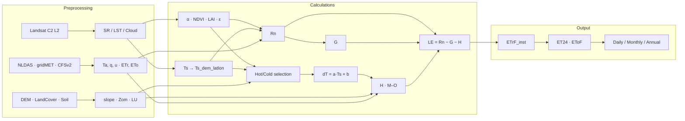

# metric-ee

**OpenET eeMETRIC** (Google Earth Engine'dagi METRIC energiya balansi modeli) kodining to'liq tahlili — formulalar, funksiyalar va algoritmlar O'zbek tilida, Feynman uslubida.

> 🛰️ Manba: [`Open-ET/openet-eemetric`](https://github.com/Open-ET/openet-eemetric) v0.21.0, commit [`7c83a7d`](https://github.com/Open-ET/openet-eemetric/tree/7c83a7d058b2a0cd37cc4bc251762f9b7150d4d7) (2026-08-04) + [`Open-ET/openet-core`](https://github.com/Open-ET/openet-core) (`common.py`, `interpolate.py`).
> 📜 Asosiy maqola: Allen, R.G., Tasumi, M., Trezza, R. (2007). *Satellite-Based Energy Balance for Mapping Evapotranspiration with Internalized Calibration (METRIC) — Model*. J. Irrig. Drain. Eng., 133(4), 380–394. [doi:10.1061/(ASCE)0733-9437(2007)133:4(380)](https://doi.org/10.1061/(ASCE)0733-9437(2007)133:4(380))

---

## 🧠 METRIC bir paragrafda (Feynman)

Quyosh yer yuzasiga energiya beradi ($R_n$). Bu energiya uch "cho'ntak"ka taqsimlanadi: tuproqni isitish ($G$), havoni isitish ($H$) va suvni bug'latish ($LE$). Kosmosdan $R_n$ va $G$ ni yaxshi baholaymiz, lekin $H$ qiyin — u yuza va havo harorati farqiga ($dT$) bog'liq, havo haroratini esa sputnik ko'rmaydi. METRIC hiylasi: sahnadan **ikki etalon piksel** — juda nam (🥶 cold, sug'orilgan beda) va juda quruq (🔥 hot, shudgor) — tanlab, ularda $ET$ ni ma'lum deb hisoblaydi va $dT = a\cdot T_s + b$ chiziqni **kalibrlaydi**. Shundan keyin har bir piksel uchun:

$$LE = R_n - G - H \quad\Rightarrow\quad ET_rF = \frac{ET_{inst}}{ET_{r,inst}} \quad\Rightarrow\quad ET_{24} = ET_rF\cdot ET_{r,24}$$

Atmosfera xatolari $a$, $b$ ichiga "yutiladi" — bu **internal calibration**.

---

## 📚 Hujjatlar

| # | Hujjat | Mazmuni | Bosqich |
|---|---|---|---|
| 00 | [Arxitektura](docs/00_arxitektura.md) | `EEFlux` klassi, lazy property, hisoblash grafi, parametrlar | — |
| 01 | [Preprocessing: Landsat](docs/01_preprocessing_landsat.md) | C2 SR scale, cloud mask, ASTER emissivity, LST correction, legacy atmosfera korreksiyasi | Preprocessing |
| 02 | [Albedo, NDVI, LAI](docs/02_albedo_ndvi_lai.md) | Albedo, tall-veg tuzatish, NDVI, LAI, qor/suv flagi | Calculations |
| 03 | [Surface temperature](docs/03_surface_temperature.md) | Lapse rate, delapsing, canopy unmixing, terrain LST | Calculations |
| 04 | [Ob-havo va Reference ET](docs/04_weather_reference_et.md) | NLDAS/CFSv2/gridMET/CIMIS, ASCE soatlik/kunlik PM | Preprocessing |
| 05 | [Common products](docs/05_common_products.md) | Quyosh geometriyasi, DEM, land use, u200, tog' shamoli, tuproq | Preprocessing |
| 06 | [Net radiation](docs/06_net_radiation.md) | τ, Rso (instant/daily, flat/mountain), $R_n$, $C_{rad}$ | Calculations |
| 07 | [Soil heat flux](docs/07_soil_heat_flux.md) | $G$ quruqlik/suv/qor/wetland, residual G | Calculations |
| 08 | [Momentum roughness](docs/08_momentum_roughness.md) | Zom lookup, Perrier, suv, tog' tuzatishi | Calculations |
| 09 | [Sensible heat flux](docs/09_sensible_heat_flux.md) | ⭐ dT kalibratsiyasi, Monin–Obukhov iteratsiya, $H$, suv bug'lanishi | Calculations |
| 10 | [Pixel selection](docs/10_pixel_selection.md) | ⭐ Hot/cold avtomatik tanlash (dynamic/static), reytinglar, sifat | Calculations |
| 11 | [Spatial delapsing](docs/11_lapsed_surface_regions.md) | Lat/lon temperatura trendi, 8 ta sifat tekshiruvi | Calculations |
| 12 | [ETrF, ET24, SWB](docs/12_etrf_et24_soil_water_balance.md) | Instant → kunlik, EF/Slob, ochiq suv, FAO-56 $K_e$ | Calculations / Output |
| 13 | [Collection va interpolyatsiya](docs/13_collection_interpolation.md) | Kunlik/oylik/yillik ET, gap-filling | Output |
| 14 | [Funksiyalar indeksi](docs/14_funksiyalar_indeksi.md) | **213** funksiya — qator raqami (GitHub permalink) + vazifa | Ma'lumotnoma |
| 15 | [Formulalar shpargalkasi](docs/15_formulalar_shpargalka.md) | Barcha formulalar bir joyda | Ma'lumotnoma |
| 16 | [Kuzatuvlar va moslashtirish](docs/16_kuzatuvlar_va_moslashtirish.md) | 11 ta potensial bug, nuance'lar, 🇺🇿 O'zbekiston uchun moslashtirish, refaktoring g'oyasi | Tahlil |

---

## 🔄 Umumiy pipeline

---

## 📖 Qanday o'qish kerak

1. **Tez tushunish:** shu README → [09](docs/09_sensible_heat_flux.md) §1 → [10](docs/10_pixel_selection.md) §1 → [12](docs/12_etrf_et24_soil_water_balance.md) §1 (Feynman bo'limlari).
2. **Kodni kuzatish:** [00](docs/00_arxitektura.md) dagi graf + [14](docs/14_funksiyalar_indeksi.md) dagi permalinklar.
3. **O'z hududingizga qo'llash:** [16](docs/16_kuzatuvlar_va_moslashtirish.md) §3 (CONUS-ga bog'liq assetlar ro'yxati).

### Belgilar

| Belgi | Ma'no |
|---|---|
| 🧠 | Fizik / intuitiv tushuntirish |
| ⚠️ | Aniqlik, CRS, NoData eslatmasi |
| 🐛 | Kodda topilgan potensial xato |
| 🌍 / 🇺🇿 | CONUS'dan tashqarida ishlatish |

---

## ⚖️ Litsenziya eslatmasi

Tahlil qilingan `openet-eemetric` kodi **AGPL-3.0-only**. Bu repozitoriyada faqat tahliliy hujjatlar va qisqa kod parchalari (iqtiboslar) mavjud. Original kodni o'zgartirib tarqatsangiz, AGPL shartlariga amal qiling.
