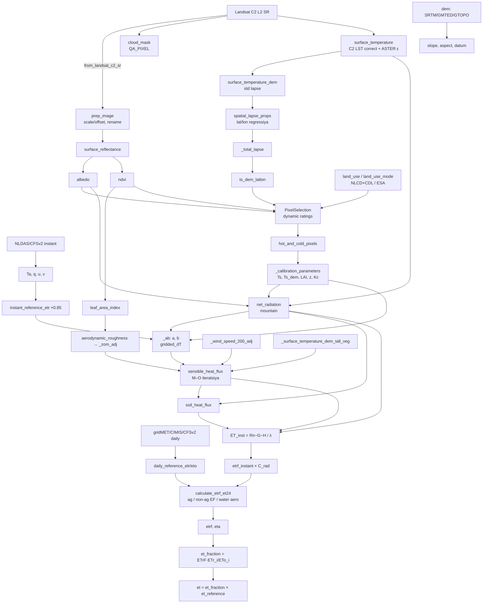

# 00 — Arxitektura: `EEFlux` klassi, lazy property va hisoblash grafi

> **Manba fayllar:** `openet/eemetric/__init__.py`, `eeflux.py` (2169 qator), `openet_utils.py`
> **Versiya:** `openet-eemetric 0.21.0` (pyproject.toml), commit `7c83a7d` (2026-08-04)
> **Litsenziya:** AGPL-3.0-only

---

## 1. Paket tuzilishi

```text
openet/eemetric/
├── __init__.py                     # Image = EEFlux, Collection, interpolate, MODEL_NAME='EEMETRIC'
├── eeflux.py                       # ⭐ EEFlux klassi — hamma narsa shu yerda "yig'iladi"
│
├── ── PREPROCESSING ──────────────
├── surface_reflectance.py          # (legacy) METRIC atmosfera korreksiyasi
├── weather.py                      # NLDAS / CFSv2 / gridMET / CIMIS
├── common_products.py              # DEM, quyosh geometriyasi, land use, u200, tuproq
│
├── ── CALCULATIONS ───────────────
├── surface_albedo.py               # α
├── vegetation_indices.py           # NDVI, LAI, tall veg
├── snow_water_flag_calculation.py  # qor / suv
├── surface_temperature.py          # Ts, lapse, canopy unmixing
├── lapsed_surface_regions.py       # spatial delapsing
├── asce_et_reference_products.py   # ETr / ETo
├── net_radiation.py                # Rn, Rso
├── soil_heat_flux.py               # G
├── momentum_roughness.py           # Zom
├── automated_pixel_selection.py    # hot / cold tanlash
├── gridded_dT.py                   # dT = a·Ts + b kalibratsiya
├── sensible_heat_flux.py           # H (Monin–Obukhov)
├── soil_water_balance.py           # Ke (FAO-56)
├── etrf_et24.py                    # ETrF, ET24
│
├── ── OUTPUT ─────────────────────
├── collection.py                   # Collection: overpass / interpolate
├── interpolate.py                  # from_scene_et_fraction
├── stretch.py                      # manual stretch
└── openet_utils.py                 # getinfo, date_0utc, ...
```

> 💡 Sizning "Preprocessing → Calculations → Output" uslubingizga deyarli mos: lekin barcha modul funksiyalari `self` (EEFlux obyekti) ni qabul qiladi — ya'ni **qattiq bog'langan** (tight coupling). Har bir modulda `*_general(...)` versiyalar ham bor — ular sof funksiyalar (argumentlar bilan), test va qayta ishlatish uchun qulay.

---

## 2. `lazy_property` — "kerak bo'lganda hisobla"

```python
def lazy_property(fn):
    attr_name = '_lazy_' + fn.__name__
    @property
    def _lazy_property(self):
        if getattr(self, attr_name, None) is None:
            setattr(self, attr_name, fn(self))
        return getattr(self, attr_name)
    return _lazy_property
```

### Feynman tushuntirish

Restoranda oshpaz barcha taomlarni oldindan pishirmaydi — buyurtma kelganda pishiradi, va bir marta pishirganini **qayta ishlatadi**. `lazy_property` ham shunday:

1. `model.et` so'raldi → `et_fraction` kerak → `etrf` kerak → `calculate_etrf_et24` → `sensible_heat_flux` → `_ab` → `hot_and_cold_pixels` → ... zanjir avtomatik "ochiladi".
2. Har bir xususiyat **bir marta** quriladi (`_lazy_<name>` da keshlanadi).

> 🧠 **Muhim:** bu yerda "hisoblash" — **EE server-side grafini qurish**. Haqiqiy piksel hisoblari faqat `getInfo()`, `Export` yoki `getThumbURL` da EE serverida bajariladi. Kesh — Python obyektlarini (graf tugunlarini) qayta ishlatish, bu grafni kichraytiradi.

`__init__` oxirida barcha `_lazy_*` atributlar `None` ga o'rnatiladi.

### Ikki xil xususiyat turi

| Tur | Misol | Xatti-harakat |
|---|---|---|
| **Override qilinadigan** `@property` | `albedo`, `ndvi`, `dem`, `surface_temperature`, `net_radiation`, `soil_heat_flux`, `land_use`, ... | `__init__` da berilsa — o'sha ishlatiladi (`assert isinstance(..., ee.Image)`); aks holda modul funksiyasi |
| **Ichki** `@lazy_property` | `etrf`, `et`, `_ab`, `_total_lapse`, `sensible_heat_flux`, ... | Har doim hisoblanadi |

Bu **dependency injection**: masalan, o'z DEM, land use yoki ob-havongizni bera olasiz:

```python
model.Image.from_landsat_c2_sr(img,
    dem=ee.Image('COPERNICUS/DEM/GLO30')...,      # ⚠️ band nomi 'elevation' ga rename qilinadi
    land_use=my_landuse_remapped_to_nlcd,
    daily_weather_series=my_era5_daily_coll,      # band nomlari qat'iy!
    conus_only=False)
```

---

## 3. `EEFlux.__init__` parametrlari va defaultlar

### 3.1 Model "toggle"lari (klass konstantalari)

| Konstanta | Default | Parametr | Ma'no |
|---|---|---|---|
| `_PIXEL_SELECTION` | `'dynamic'` | `pixel_selection` | `'static'` / `'dynamic'` |
| `_TS_MODEL` | `'tall_vegetation'` | `ts_model` | `'tall_vegetation'` / `'min_albedo'` / `'default'` |
| `_LAPSE_FLAT` | 3.0 K/km | `lapse_flat` | [0, 10] |
| `_LAPSE_MTN` | 6.5 K/km | `lapse_mtn` | [0, 10] |
| `_CZOM_ADJ` | 0.5 | `czom_adj` | Tog' Zom tuzatishi [0, 1] |
| `_WIND_ADJ` | 0.5 | `wind_adj` | Tog' shamoli [0, 1] |
| `_LEEWARD_ADJ` | 1.0 | `leeward_adj` | Leeward [0, 2] |
| `_CPSI_COEFF` | 1.0 | `cpsi_coeff` | Buoyancy [0, 1] |
| `_TALL_CROPS_TOGGLE` | 1 | `tall_crops_toggle` | Bog'/tokzorlarni tall veg deb hisoblash |
| `_TALL_CROPS_ZOM_TOGGLE` | 1 | `tall_crops_zom_toggle` | Bog'lar uchun Perrier Zom |
| `_SPATIAL_DELAPSING` | True | `spatial_delapsing` | [11](11_lapsed_surface_regions.md) |
| `_CONUS_ONLY` | **True** | `conus_only` | ⚠️ AQShdan tashqarida **False** qiling |
| `_C2_LST_CORRECT` | True | `c2_lst_correct` (faqat `from_landsat_c2_sr`) | ASTER emissivity bilan LST |
| `_CROP_TYPE_COLL_ID` | `projects/openet/assets/crop_type/v2024a` | `crop_type_coll_id` | |
| `_SOIL_WATER_BALANCE_SPINNING_DAYS` | 10 | — | |

### 3.2 Kirish ma'lumotlari (override qilinadigan)

`image_raw`, `image`, `toa_image`, `dem`, `instant_air_temperature` (°C), `instant_specific_humidity`, `instant_wind_speed_u/v`, `instant_incoming_sw_clear_sky`, `daily_weather_series` (ImageCollection), `land_use`, `land_use_mode`, `surface_reflectance`, `albedo`, `ndvi`, `net_radiation`, `soil_heat_flux`, `surface_temperature` (K), `daily_evaporation_bare_soil`, `aerodynamic_roughness`, `leaf_area_index`, `hot_and_cold_pixels`, `hot_pixel_etrf`, `cold_pixel_etrf`, `soil_wilting_point`, `soil_field_capacity`, `bqa_mask`, `bqa_band`, `simple_cloud_score`, `cloud_mask`, `et_reference_*`.

`**kwargs` — faqat `_ALLOWED_ARGS` dagi `_`-prefiksli nomlar (masalan `_user_hot_cold_pixel`). Boshqasi → `Exception`.

### 3.3 `__init__` da darhol bajariladigan ishlar

```python
self._p_air = common_products.calculate_air_pressure(self.dem)                  # P(z)
self._sat_pass_weath = weather.calculate_overpass_global_weather(image_raw, conus_only)
```

### 3.4 `scale`

```python
scale = image_raw.select([band_one]).projection().nominalScale().multiply(4.0)   # 30 m × 4 = 120 m
```

Barcha `reduceRegion`/`reduceRegions` statistikalari shu masshtabda (tezlik va EE xotira uchun).

---

## 4. Hisoblash grafi (asosiy oqim)



---

## 5. EEFlux xususiyatlari xaritasi

| Xususiyat | Modul funksiyasi | Hujjat |
|---|---|---|
| `dem` | `common_products.calculate_dem` | [05](05_common_products.md) |
| `instant_air_temperature`, `instant_specific_humidity`, `instant_wind_speed_u/v` | `weather.calculate_overpass_global_weather` | [04](04_weather_reference_et.md) |
| `instant_wind_speed` | $\sqrt{u^2+v^2}$ | [04](04_weather_reference_et.md) |
| `instant_incoming_sw_clear_sky` | `net_radiation.calculate_instant_rso` | [06](06_net_radiation.md) |
| `daily_weather_series` | `weather.calculate_daily_weather_series_composite` | [04](04_weather_reference_et.md) |
| `daily_reference_etr/eto(_series)` | seriya + `calculate_scene_solar_day_start_end` | [04](04_weather_reference_et.md) |
| `daily_air_temperature_min/max`, `daily_specific_humidity`, `daily_wind_speed`, `daily_sw_radiation` | `_daily_weather_overpass_date` | [04](04_weather_reference_et.md) |
| `albedo` | `surface_albedo.calculate_surface_albedo` | [02](02_albedo_ndvi_lai.md) |
| `albedo_tall_vegetation`, `_albedo_adj` | `calculate_albedo_tall_veg_adj`, `calculate_albedo_adj` | [02](02_albedo_ndvi_lai.md) |
| `ndvi`, `leaf_area_index` | `vegetation_indices` | [02](02_albedo_ndvi_lai.md) |
| `_tall_veg_flag`, `tall_crops_flag`, `grapes_mask` | `calculate_tall_veg_id`, `calculate_land_use_usa` | [02](02_albedo_ndvi_lai.md), [05](05_common_products.md) |
| `_snow_water_flag` | `calculate_snow_water_flag` | [02](02_albedo_ndvi_lai.md) |
| `surface_temperature` | C2 LST correct (openet-core) | [01](01_preprocessing_landsat.md) |
| `surface_temperature_dem`, `_std_lapse`, `_total_lapse`, `ts_dem_latlon`, `ts_dem_latlon_alb_adj` | `surface_temperature.*` | [03](03_surface_temperature.md) |
| `_surface_temperature_tall_veg`, `_surface_temperature_dem_tall_veg`, `_surface_temperature_terrain` | `calculate_lst_*` | [03](03_surface_temperature.md) |
| `_mt_toggle`, `_mt_lapse_elev` | `calc_mountain_toggle`, `find_elev_for_lapse_rate_change` | [03](03_surface_temperature.md) |
| `spatial_lapse_props`, `_spatial_lapse`, `spatial_delapsing_applied`, `spatial_regression_coeffs` | `lapsed_surface_regions` | [11](11_lapsed_surface_regions.md) |
| `land_use`, `land_use_mode` | `calculate_land_use_combined(_mode)` | [05](05_common_products.md) |
| `cloud_mask` / `cloud_mask_openet` / `mask` | `calculate_cloud_mask` / morfologiya | [01](01_preprocessing_landsat.md) |
| `_slope`, `_aspect`, `_datum`, `_doy`, `_ea`, `_relative_humidity`, `_cos_theta`, `_cos_theta_mountain`, `_std_elev`, `_rel_elev` | `common_products.*` | [05](05_common_products.md) |
| `_wind_speed_200_aero`, `_wind_speed_200` (≥5), `_wind_speed_200_adj(_aero)` | `calculate_u200(_adj)` | [05](05_common_products.md) |
| `aerodynamic_roughness(_nonwater)`, `_zom_adj`, `_rextra` | `momentum_roughness.*` | [08](08_momentum_roughness.md) |
| `pixel_ratings`, `hot_and_cold_pixels`, `_calibration_parameters`, `_hot/_cold_candidates`, `_kc_*`, `_ts_*`, `_ts_dem_*`, `calibration_rating`, `hot/cold_pixel_etrf` | `automated_pixel_selection` | [10](10_pixel_selection.md) |
| `_ab`, `_dt_props` | `gridded_dT.calculate_gridded_dt` | [09](09_sensible_heat_flux.md) |
| `sensible_heat_flux`, `_evapor_water` | `sensible_heat_flux.calculate_sensible_heat_flux` | [09](09_sensible_heat_flux.md) |
| `net_radiation` | `net_radiation.calculate_net_radiation_mountain` | [06](06_net_radiation.md) |
| `soil_heat_flux` | `soil_heat_flux.calculate_soil_heat_flux` | [07](07_soil_heat_flux.md) |
| `daily_evaporation_bare_soil` | `soil_water_balance.calculate_soil_water_balance` | [12](12_etrf_et24_soil_water_balance.md) |
| `etrf_instant`, `etrf`, `eta`, `etof`, `et_fraction`, `et_reference`, `et`, `daily_net_radiation_slob` | `etrf_et24.*` | [12](12_etrf_et24_soil_water_balance.md) |
| `export_props`, `calibration_props_for_export` | `EEFluxExportCalibrations` | §7 |
| `time` | 0 UTC millis band | [13](13_collection_interpolation.md) |

---

## 6. `calculate(variables)` — chiqish tasviri

```python
output = model_obj.calculate(['et', 'et_reference', 'et_fraction'])
```

- `getattr(self, v)` har o'zgaruvchi uchun → `ee.Image.cat`.
- `system:index`, `system:time_start`, `image_id` o'rnatiladi.
- `et_fraction` so'ralganda: `.updateMask(self.mask)` (production cloud mask) + `.copyProperties(export_props)` — barcha kalibratsiya metadata'si qo'shiladi (`QUALITY`, `KC_HOT`, `TS_COLD`, `A`, `B`, `lon_coeff`, ...).

> ⚠️ `export_props` hisoblash og'ir (kalibratsiyani to'liq bajaradi). Faqat ID lar kerak bo'lsa `et_fraction` ni so'ramang.

---

## 7. Boshqa klasslar

| Klass | Vazifa |
|---|---|
| `EEFluxFlat(EEFlux)` | Tekis relyef versiyasi: flat SR, flat Rso, flat G, flat Rn, flat H (`ts_model='default'`), $C_{rad}$ yo'q, **majburan** `conus_only=False` |
| `EEFluxPreCalibrated(EEFlux)` | Oldindan hisoblangan kalibratsiya (`LON_HOT`, `KC_HOT`, `A`, `B`, ...) bilan |
| `EEFluxFlatPreCalibrated(EEFluxFlat)` | Flat + pre-calibrated |
| `EEFluxExportCalibrations` | Kalibratsiya parametrlarini xususiyat sifatida eksport (`KC`, `RATE`, `TSDEMLATLON`, `ELEV`, `LAI`, `LON`, `TS`, `LAT` × `_HOT/_COLD`) |
| `EEFluxFlatExportCalibrations` | Flat versiya |

`get_anchor_pixels(sr_image, collection_id)` — boshqa kolleksiyadagi kalibratsiyadan `_user_hot_cold_pixel`, `_hot_pixel_etrf`, `_cold_pixel_etrf` model argumentlarini yasaydi (ensemble/qayta ishlash uchun).

> 🐛 `EEFluxPreCalibrated.__init__` `super().__init__(eeflux, dem, instant_air_temperature, ...)` ni **pozitsion** argumentlar bilan chaqiradi, lekin `EEFlux.__init__` signaturasida 2-o'rinda `image`, 3-da `toa_image` turadi → `dem` → `image` ga, `instant_air_temperature` → `toa_image` ga tushadi. Bu klasslar hozirgi kodda ishlatilmasa ham, ishlatishdan oldin **keyword** argumentlarga o'tkazish kerak.

---

## 8. `openet_utils.py`

| Funksiya | Vazifa |
|---|---|
| `getinfo(obj, n=4)` | `getInfo()` + "memory capacity exceeded" da $i^2$ s kutish |
| `constant_image_value`, `point_image_value`, `point_coll_value` | Test yordamchilari |
| `date_0utc(date)` | `ee.Date.fromYMD(y, m, d)` — 0 UTC |
| `is_number`, `millis`, `valid_date` | Validatsiya |
