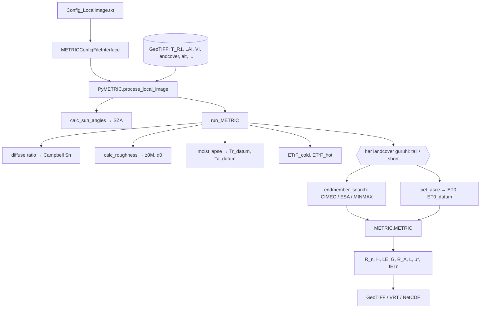

# pyMETRIC (Hector Nieto, IRTA) — kod tahlili

**pyMETRIC** — METRIC modelining lokal rasterlar (GeoTIFF) uchun yozilgan NumPy + GDAL implementatsiyasi. U **pyTSEB** kutubxonasiga (resistances, Monin–Obukhov, net radiation, meteo) tayanadi.

> 🛰️ **Manba:** foydalanuvchi yuklagan `pyMETRIC-master_1.zip` (setup.py: `version="1.0"`). Upstream: [hectornieto/pyMETRIC](https://github.com/hectornieto/pyMETRIC).
> 🔗 **Bog'liqlik:** [hectornieto/pyTSEB](https://github.com/hectornieto/pyTSEB). Funksiyalar commit [`ccec8e3`](https://github.com/hectornieto/pyTSEB/tree/ccec8e3c93aed72f4d0ce3563d3e2f149f76e370) (2026-10-16) bo'yicha tahlil qilingan. Sizning o'rnatgan pyTSEB versiyangiz farq qilishi mumkin.
> 📜 **Litsenziya:** GPL-3.0 (LICENSE), fayl sarlavhalarida LGPL-3.0.
> 🏷️ **Git tag:** `pymetric-nieto-v1.0`

---

## 🧠 Bir paragrafda (Feynman)

Bu versiya "laboratoriya asbobi"ga o'xshaydi. U o'zi Landsat yuklamaydi va ob-havo olib kelmaydi. Siz unga tayyor rasterlarni berasiz (LST, LAI, NDVI, landcover, DEM), meteo qiymatlarni esa son yoki raster ko'rinishida berasiz. Model ikki etalon pikselni topadi: 🥶 **cold** (eng sovuq va yashil) hamda 🔥 **hot** (eng issiq va quruq). Shu ikki nuqtada $H = R_n - G - LE$ ni biladi va undan $dT = a + b\,T_{datum}$ chizig'ini quradi. Keyin har piksel uchun Monin–Obukhov iteratsiyasi bilan $H$ ni, qoldiq sifatida esa $LE$ ni hisoblaydi:

$$LE = R_n - G - H,\qquad fETr = \frac{LE}{LE_{ref}}$$

Bunda hamma narsa **W/m²** da (instant oqimlar). Kunlik ET ga o'tish bu kodda **yo'q**.

---

## 📚 Hujjatlar

| # | Hujjat | Mazmuni |
|---|---|---|
| 00 | [Arxitektura](docs/00_arxitektura.md) | Fayllar, `PyMETRIC` klassi, konfiguratsiya, ma'lumot oqimi |
| 01 | [Kirish va radiatsiya](docs/01_kirish_va_radiatsiya.md) | Quyosh burchaklari, diffuz ulush, Campbell $S_n$, emissivity, albedo, $L_{dn}$, $z_{0M}$/$d_0$, G variantlari |
| 02 | [METRIC yadrosi](docs/02_metric_yadro.md) | `METRIC()`: datum, ρ, $c_p$, $u_*$, L, $R_A$, dT, iteratsiya va konvergensiya |
| 03 | [Endmember search](docs/03_endmember_search.md) | CIMEC, ESA (Bhattarai 2017), MINMAX, CV filtr, ETrF cold/hot |
| 04 | [Reference ET](docs/04_reference_et.md) | `pet_asce`, `pet_fao56`, `calc_Ln` va raqamli tekshiruv |
| 05 | [Funksiyalar indeksi](docs/05_funksiyalar_indeksi.md) | Barcha funksiyalar (qator raqami bilan) + ishlatilgan pyTSEB funksiyalari |
| 06 | [Kuzatuvlar](docs/06_kuzatuvlar.md) | Potensial buglar, birlik nomuvofiqliklari, CRS va NoData eslatmalari |

## 🔄 Pipeline

