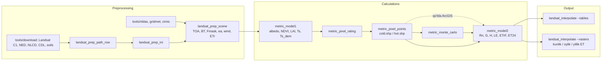

# pymetric (WSWUP / DRI) — kod tahlili

**pymetric** — Desert Research Institute (DRI) va WSWUP jamoasining METRIC uchun to'liq **lokal Landsat pipeline**'i. U ma'lumot yuklab olish, sahnani tayyorlash, Model 1 (yuza xususiyatlari), pixel rating, Model 2 (energiya balansi), Monte Carlo avtokalibratsiya va mavsumiy interpolyatsiyani o'z ichiga oladi. Kod GDAL + NumPy + `drigo` asosida yozilgan.

> 🛰️ **Manba:** foydalanuvchi yuklagan `pymetric-master.zip`. U [WSWUP/pymetric](https://github.com/WSWUP/pymetric) `master` (commit [`c3a47fb`](https://github.com/WSWUP/pymetric/tree/c3a47fb0d5f98dd8746f557038b6291350ea0916), 2022-07-01) bilan **bayt-bayt bir xil** (`diff -rq` tekshirildi). `VERSION.txt`: **0.2.3**.
> 📜 **Litsenziya:** Apache-2.0
> 🏷️ **Git tag:** `pymetric-wswup-v0.2.3`

---

## 🧠 Bir paragrafda (Feynman)

Bu versiya — "konveyer liniyasi". Har bir skript bitta stanok: avval Landsat arxivini yuklaydi va kesadi, keyin Model 1 albedo, NDVI, LAI va $T_s$ ni hisoblaydi. Pixel rating "nomzod" piksellarni belgilaydi. **Mutaxassis** ArcGIS'da hot/cold nuqtani qo'lda to'g'rilaydi (yoki Monte Carlo avtomatik tanlaydi). Model 2 $dT = a\,T_{s,dem} + b$ ni kalibrlab, $H$, $LE$ va ETrF ni chiqaradi. Oxirida interpolyatsiya siyrak ETrF sahnalaridan kunlik, oylik va yillik ET xaritasini yasaydi:

$$ET_{24} = ET_rF\cdot ET_{r,24},\qquad ET_{oy} = \sum_d ET_rF_d^{interp}\cdot ET_{r,d}$$

---

## 📚 Hujjatlar

| # | Hujjat | Mazmuni | Bosqich |
|---|---|---|---|
| 00 | [Arxitektura](docs/00_arxitektura.md) | Skriptlar ketma-ketligi, papka tuzilishi, INI fayllar, bog'liqliklar | — |
| 01 | [Landsat tayyorlash](docs/01_prep_landsat.md) | `et_image` koeffitsientlari, TOA, BT, Fmask, NLDAS vaqt interpolyatsiyasi | Preprocessing |
| 02 | [Model 1](docs/02_model1.md) | cos θ, Tasumi SR, albedo, NDVI/SAVI/LAI, emissivity, $T_s$, delapse | Calculations |
| 03 | [Pixel rating va points](docs/03_pixel_rating_points.md) | Region mask, Ts/NDVI/albedo/NLCD reyting, tasodifiy nuqta | Calculations |
| 04 | [Model 2](docs/04_model2.md) | $R_n$, $G$, $Z_{om}$, $u_{200}$, kalibratsiya iteratsiyasi, $H$, ETrF, ET24 | Calculations |
| 05 | [Avtokalibratsiya va Monte Carlo](docs/05_auto_calibration_monte_carlo.md) | Tail size, Kc tuzatish, SWB hot Kc | Calculations |
| 06 | [Interpolyatsiya](docs/06_interpolation.md) | Mozaika, end/temporal fill, linear/cubic, kunlik/oylik/yillik | Output |
| 07 | [Tools: ob-havo va RefET](docs/07_tools_weather.md) | NLDAS, gridMET, CIMIS, Daymet, yuklab olish | Preprocessing |
| 08 | [Funksiyalar indeksi](docs/08_funksiyalar_indeksi.md) | Asosiy modullardagi barcha funksiyalar (qator raqami bilan) | Ma'lumotnoma |
| 09 | [Kuzatuvlar](docs/09_kuzatuvlar.md) | Potensial buglar, eskirgan qismlar, CRS va NoData eslatmalari | Tahlil |

## 🔄 Pipeline

